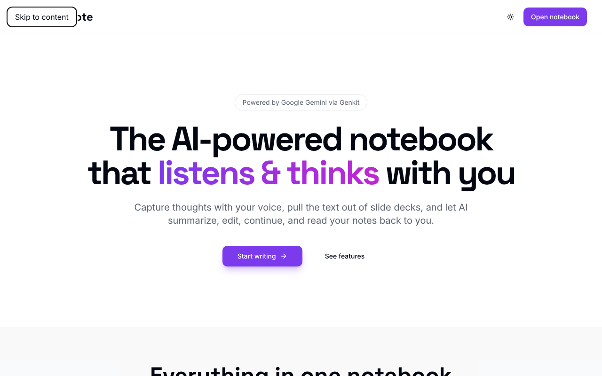
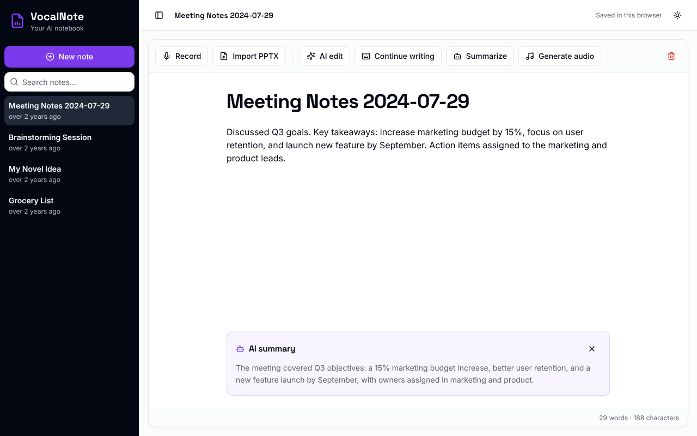
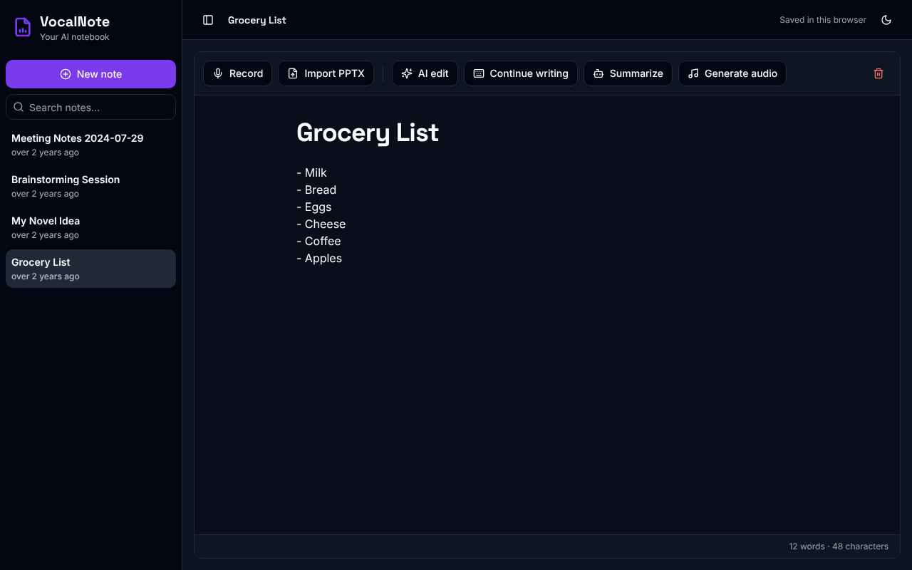
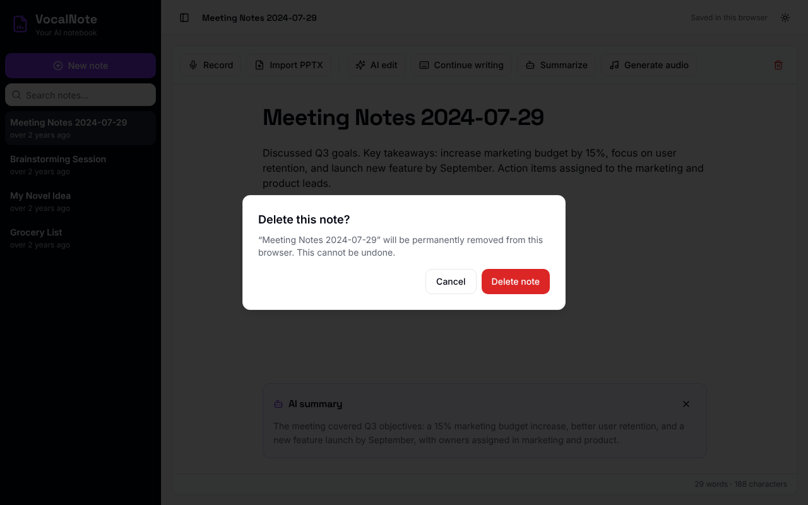
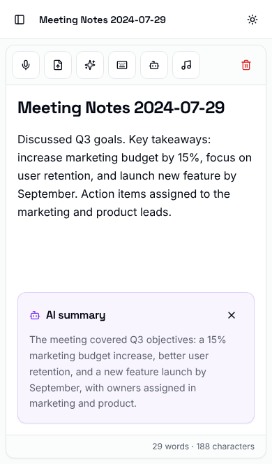
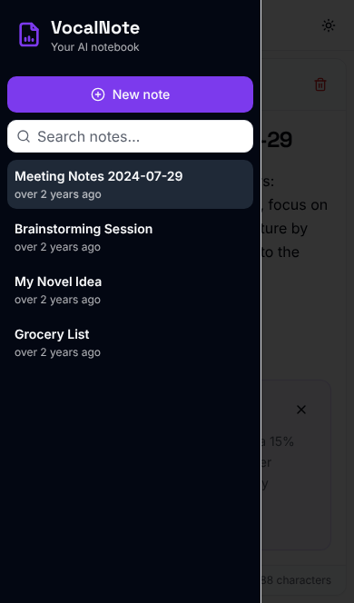
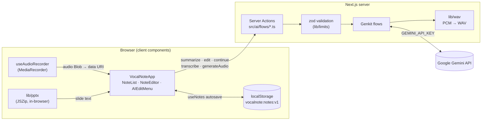

# VocalNote

**An AI-powered notebook that listens and thinks with you.** Dictate notes, pull the text out of PowerPoint decks, and
let Google Gemini summarize, rephrase, translate, proofread, continue and read your notes aloud.


<a href="https://studio.firebase.google.com/import?url=https%3A%2F%2Fgithub.com%2Fjeevithg090%2Fstudio">
  
</a>

---

## Contents

- [Overview](#overview)
- [Screenshots](#screenshots)
- [Features](#features)
- [Tech stack](#tech-stack)
- [Architecture](#architecture)
- [Getting started](#getting-started)
- [Configuration](#configuration)
- [Usage](#usage)
- [Server Actions reference](#server-actions-reference)
- [Scripts](#scripts)
- [Testing and code quality](#testing-and-code-quality)
- [Deployment](#deployment)
- [Project structure](#project-structure)
- [Troubleshooting and FAQ](#troubleshooting-and-faq)
- [Known limitations](#known-limitations)
- [Roadmap ideas](#roadmap-ideas)
- [Contributing](#contributing)
- [License](#license)

## Overview

Notes come from many places: something said in a meeting, a lecture slide deck, a half-finished idea. Turning that raw
material into something useful usually means retyping, summarizing and editing by hand. VocalNote puts capture and
refinement in one editor:

- **Capture:** type, record your voice, or import a `.pptx` deck.
- **Refine:** summarize, rephrase, fix grammar, translate, or have the AI continue your train of thought.
- **Consume:** listen to any note as generated speech.

It's built for students turning lectures into study notes, professionals capturing meetings, and writers who think
out loud. It needs **no account and no database**: notes are saved in your browser, and only the text or audio you send
to an AI feature leaves your device.

## Screenshots

All screenshots were captured from the running app with the built-in sample notes.

| Landing page                                          | Notebook (light)                                                       |
| ----------------------------------------------------- | ---------------------------------------------------------------------- |
|  |  |

| Notebook (dark)                                                      | Delete confirmation                                                     |
| -------------------------------------------------------------------- | ----------------------------------------------------------------------- |
|  |  |

| Phone: editor                                                                        | Phone: note list                                                                                      |
| ------------------------------------------------------------------------------------ | ----------------------------------------------------------------------------------------------------- |
|  |  |

## Features

| Feature                          | Details                                                                                                                                                                                                                                             |
| -------------------------------- | --------------------------------------------------------------------------------------------------------------------------------------------------------------------------------------------------------------------------------------------------- |
| 🎙️ **Speech-to-text**            | Record with the microphone (`MediaRecorder`; WebM in Chrome, MP4 in Safari). Gemini transcribes the clip and the text is appended to the note.                                                                                                      |
| 📄 **PowerPoint import**         | `.pptx` files are unzipped and parsed **in the browser** with JSZip, following the deck order in `presentation.xml`. Nothing is uploaded.                                                                                                           |
| 🤖 **AI summary**                | A concise paragraph of key points and action items, shown in a dismissible card under the note.                                                                                                                                                     |
| ✍️ **AI editing**                | Rephrase, fix grammar, or translate into Spanish, French, German, Hindi, Japanese or Mandarin Chinese.                                                                                                                                              |
| ⌨️ **Continue writing**          | Gemini writes the next one or two paragraphs in your style and tone.                                                                                                                                                                                |
| 🎧 **Text-to-speech**            | Gemini TTS turns the note into a WAV file that plays in a built-in audio player.                                                                                                                                                                    |
| 💾 **Autosave**                  | Every edit is saved to `localStorage`, and the header shows the save status. Large generated audio is dropped first if storage runs out.                                                                                                            |
| 🔎 **Search**                    | Instant, case-insensitive filtering by title and content.                                                                                                                                                                                           |
| 🌗 **Light and dark themes**     | Light, dark or follow the system, switchable from any page.                                                                                                                                                                                         |
| 📱 **Responsive and accessible** | Layouts checked at 375, 768 and 1280 px. Phones get a slide-over note list and 40 px touch targets. Includes a skip link, landmarks, labelled controls, visible focus rings and live status announcements, and passes an axe-core WCAG 2 A/AA scan. |

## Tech stack

| Layer      | Technology                                                                                                                                                                                 |
| ---------- | ------------------------------------------------------------------------------------------------------------------------------------------------------------------------------------------ |
| Framework  | [Next.js 15](https://nextjs.org/) App Router with Server Actions, React 18                                                                                                                 |
| Language   | TypeScript (strict mode)                                                                                                                                                                   |
| AI         | [Genkit 1.x](https://genkit.dev/) and [`@genkit-ai/google-genai`](https://genkit.dev/docs/js/integrations/google-genai/) (Gemini text, audio and TTS models)                               |
| Validation | [zod](https://zod.dev/) schemas on every AI flow                                                                                                                                           |
| UI         | [shadcn/ui](https://ui.shadcn.com/) (Radix UI), [Tailwind CSS 3](https://tailwindcss.com/), [lucide-react](https://lucide.dev/), [next-themes](https://github.com/pacocoursey/next-themes) |
| Fonts      | Inter and Space Grotesk via `next/font` (self-hosted at build time)                                                                                                                        |
| Files      | [JSZip](https://stuk.github.io/jszip/) for client-side `.pptx` parsing, plus a hand-written WAV encoder                                                                                    |
| Quality    | ESLint 9 (`next/core-web-vitals`, `next/typescript`), Prettier, Vitest                                                                                                                     |
| Hosting    | [Firebase App Hosting](https://firebase.google.com/docs/app-hosting) (`apphosting.yaml`), or any Node.js 22+ host                                                                          |

## Architecture



Key design decisions:

- **Server Actions as the API.** Each AI feature is a Genkit flow wrapped in an exported `'use server'` function. The
  client calls it like a normal async function, and the Gemini API key never reaches the browser.
- **Validate before calling a model.** Every flow checks its input with zod: note text up to 30,000 characters, TTS
  input up to 5,000 characters, recordings up to 8 MB, and audio data URIs only. Limits live in `src/lib/limits.ts` and
  the UI checks them first so it can show friendly messages.
- **Local-first storage.** Notes load after mount (no hydration mismatch) and are serialized with dates revived. Bad
  entries are skipped, and if the quota is exceeded the notes are saved again without generated audio.
- **Logic lives outside React.** Note operations, storage, PPTX parsing, WAV encoding and data-URI parsing are plain
  TypeScript in `src/lib`, with unit tests.

## Getting started

### Prerequisites

- **Node.js 22 or newer** and npm
- A **Gemini API key** from [Google AI Studio](https://aistudio.google.com/app/apikey). You only need it for the AI features.

### Installation

```bash
# 1. Clone
git clone https://github.com/jeevithg090/studio.git vocalnote
cd vocalnote

# 2. Install the exact dependency versions from the lockfile
npm ci

# 3. Configure
cp .env.example .env.local
#    then edit .env.local and set GEMINI_API_KEY=...

# 4. Start the dev server
npm run dev
#    → http://localhost:9002
```

### Production mode

```bash
npm run build
npm start          # http://localhost:3000 (set PORT to change it)
```

## Configuration

Set these in `.env.local` for local development, or in your host's environment or secret manager in production.

| Variable               | Required | Default                | Description                                                               |
| ---------------------- | -------- | ---------------------- | ------------------------------------------------------------------------- |
| `GEMINI_API_KEY`       | For AI   | none                   | Gemini API key. `GOOGLE_API_KEY` or `GOOGLE_GENAI_API_KEY` also work.     |
| `VOCALNOTE_TEXT_MODEL` | No       | `gemini-flash-latest`  | Model used for summaries, edits, continuation and transcription.          |
| `VOCALNOTE_TTS_MODEL`  | No       | `gemini-3.8-flash-tts` | Text-to-speech model. Both WAV and raw-PCM outputs are handled.           |
| `VOCALNOTE_TTS_VOICE`  | No       | `Algenib`              | Prebuilt Gemini TTS voice name.                                           |
| `NEXT_PUBLIC_SITE_URL` | No       | none                   | Public base URL, used to make Open Graph and Twitter image URLs absolute. |
| `PORT`                 | No       | `3000`                 | Port for `npm start`. `npm run dev` always uses 9002.                     |

Without `GEMINI_API_KEY` the notebook still works fully offline: writing, search, delete, autosave and PPTX import.
Only the AI buttons fail, with an error message.

## Usage

### A typical session

1. Open the landing page and click **Start writing**. The notebook opens at `/notes` with four sample notes.
2. Click **New note**, give it a title, and type. Changes autosave; the header shows _Saved in this browser_.
3. Click **Record** (🎙️) and allow microphone access. Speak, then click **Stop recording**. The transcript is appended
   as a new paragraph.
4. Click **Import PPTX** (📄) and choose a deck. Each slide's text is appended under a `Slide N` heading, and the footer
   shows _Imported from deck.pptx_.
5. Use **AI edit** (✨) to rephrase, fix grammar or translate. Use **Continue writing** (⌨️) to extend the text, or
   **Summarize** (🤖) to add a summary card.
6. Click **Generate audio** (🎵) to get a playable recording of the note.
7. Use the search box to find notes, and the trash icon to delete one (with confirmation).

On phones and tablets the toolbar shows icons only. Each icon has a tooltip and an accessible label.

### Example: what a PPTX import produces

A two-slide deck becomes:

```text
Slide 1
Lecture 1: Photosynthesis

Slide 2
Light reactions & Calvin cycle
```

### Example: calling a flow from code

The flows are ordinary async functions you can import into any server or client component:

```ts
import { summarizeNote } from '@/ai/flows/summarize-note';

const { summary } = await summarizeNote({ noteContent: 'Discussed Q3 goals…' });
```

To run a flow on its own and inspect its trace, start the Genkit developer UI with `npm run genkit:dev`.

## Server Actions reference

The app has no REST routes. Every backend operation is a Next.js Server Action, called with a POST to the page URL. Next.js handles that request; you don't build it yourself.

| Action (module)                                 | Input                                                                                                              | Output                                        | Auth | Description                   |
| ----------------------------------------------- | ------------------------------------------------------------------------------------------------------------------ | --------------------------------------------- | ---- | ----------------------------- |
| `summarizeNote` (`ai/flows/summarize-note`)     | `{ noteContent: string }` (1–30,000 chars)                                                                         | `{ summary: string }`                         | None | Summarizes a note.            |
| `editNoteWithAI` (`ai/flows/edit-note-ai`)      | `{ content, action: 'rephrase' \| 'translate' \| 'fix grammar', language? }` (`language` required for `translate`) | `{ editedContent: string }`                   | None | Rewrites the whole note.      |
| `continueWriting` (`ai/flows/continue-writing`) | `{ content: string }` (1–30,000 chars)                                                                             | `{ continuedText: string }`                   | None | Writes the next paragraph(s). |
| `transcribeAudio` (`ai/flows/transcribe-audio`) | `{ audioDataUri: 'data:audio/<type>;base64,…' }` (≤ 8 MB decoded)                                                  | `{ transcribedText: string }`                 | None | Speech-to-text.               |
| `generateAudio` (`ai/flows/generate-audio`)     | `{ text: string }` (1–5,000 chars)                                                                                 | `{ audioDataUri: 'data:audio/wav;base64,…' }` | None | Text-to-speech.               |

Invalid input is rejected before any model call. In production builds, Next.js redacts server error messages, and the UI
shows a generic "Something went wrong" message. The full error appears in the server logs.

> **Security note:** these actions are unauthenticated. See [Known limitations](#known-limitations).

## Scripts

| Command                | What it does                                                   |
| ---------------------- | -------------------------------------------------------------- |
| `npm run dev`          | Dev server with Turbopack on port 9002                         |
| `npm run build`        | Production build (fails on type or lint errors)                |
| `npm start`            | Serve the production build                                     |
| `npm test`             | Run the unit tests once (Vitest)                               |
| `npm run test:watch`   | Run the tests in watch mode                                    |
| `npm run lint`         | ESLint                                                         |
| `npm run typecheck`    | `tsc --noEmit`                                                 |
| `npm run format`       | Format everything with Prettier                                |
| `npm run format:check` | Check formatting without writing                               |
| `npm run check`        | Typecheck, lint, format check and tests, all in one            |
| `npm run genkit:dev`   | Genkit developer UI for running and tracing flows on their own |
| `npm run genkit:watch` | Same, reloading on file changes                                |

## Testing and code quality

```bash
npm test          # 61 unit tests
npm run check     # everything a pull request should pass
```

| Test file                      | What it covers                                                                                                                   |
| ------------------------------ | -------------------------------------------------------------------------------------------------------------------------------- |
| `src/lib/notes.test.ts`        | Creating, updating, deleting (including which note gets selected next), search, word count, text joining, titles from file names |
| `src/lib/note-storage.test.ts` | Round-trip serialization, malformed or partial data, quota-exceeded fallback, unreadable storage                                 |
| `src/lib/pptx.test.ts`         | XML entities, runs and line breaks, deck order from `presentation.xml`, fallback ordering, invalid files                         |
| `src/lib/wav.test.ts`          | RIFF/WAVE header fields, stereo and other sample rates, WAV passthrough and PCM wrapping                                         |
| `src/lib/data-uri.test.ts`     | Data-URI parsing (MIME parameters, rejection of malformed input) and decoded-size calculation                                    |

The AI flows themselves call an external API and have no automated tests. Exercise them by hand, or with
`npm run genkit:dev`.

Code style is enforced by ESLint (Next.js core-web-vitals and TypeScript rules) and Prettier: single quotes, semicolons,
120-character lines.

## Deployment

### Firebase App Hosting (the project's existing setup)

1. In the Firebase console, open **App Hosting** and create a backend connected to this GitHub repository and branch.
2. Store the Gemini key as a secret:
   ```bash
   firebase apphosting:secrets:set gemini-api-key
   ```
3. Give the backend access to the secret by adding this to `apphosting.yaml`:
   ```yaml
   runConfig:
     maxInstances: 1
   env:
     - variable: GEMINI_API_KEY
       secret: gemini-api-key
   ```
4. Push to the live branch. App Hosting runs `npm run build` and serves the app with `npm start`.

`maxInstances: 1` keeps costs predictable. Raise it in `apphosting.yaml` if you need more capacity.

### Any Node.js host (VM, container, PaaS)

```bash
npm ci
npm run build
GEMINI_API_KEY=your-key PORT=8080 npm start
```

Server Actions accept request bodies of up to **12 MB** (set in `next.config.ts`) so voice recordings fit. Make sure
any reverse proxy in front of the app (nginx `client_max_body_size`, for example) allows at least that.

The app sets these security headers on every response: `X-Content-Type-Options`, `Referrer-Policy`,
`X-Frame-Options: DENY`, and a `Permissions-Policy` that allows the microphone for this site only.

## Project structure

```text
.
├── apphosting.yaml            # Firebase App Hosting runtime settings
├── docs/
│   ├── blueprint.md           # Original product and style brief
│   └── screenshots/           # README screenshots, captured from the running app
├── next.config.ts             # Security headers, Server Action body limit, server-only packages
├── tailwind.config.ts         # Design tokens (colors from CSS variables, fonts, animations)
├── vitest.config.mts
├── eslint.config.mjs
├── .env.example               # Every supported environment variable
└── src/
    ├── ai/
    │   ├── genkit.ts          # Genkit instance; model and voice settings
    │   ├── dev.ts             # Entry point for `npm run genkit:dev`
    │   └── flows/             # One Server Action and Genkit flow per AI feature
    │       ├── summarize-note.ts
    │       ├── edit-note-ai.ts
    │       ├── continue-writing.ts
    │       ├── transcribe-audio.ts
    │       └── generate-audio.ts
    ├── app/
    │   ├── layout.tsx         # Fonts, metadata, theme provider, toaster
    │   ├── page.tsx           # Landing page (/)
    │   ├── notes/page.tsx     # Notebook (/notes)
    │   ├── error.tsx          # Error boundary
    │   ├── not-found.tsx      # 404 page
    │   ├── icon.svg           # App icon (favicon.ico is the legacy fallback)
    │   ├── opengraph-image.tsx# Social preview image, generated at build time
    │   └── globals.css        # Light and dark theme tokens, reduced-motion rules
    ├── components/
    │   ├── vocal-note-app.tsx # App shell: sidebar, header, save status, empty and loading states
    │   ├── note-list.tsx      # Searchable note list
    │   ├── note-editor.tsx    # Editor, toolbar, AI actions, result cards
    │   ├── ai-edit-menu.tsx   # Rephrase, grammar and translate menu
    │   ├── landing-page.tsx
    │   ├── theme-toggle.tsx   # Light, dark and system switch
    │   ├── theme-provider.tsx
    │   ├── logo.tsx
    │   └── ui/                # shadcn/ui primitives in use
    ├── hooks/
    │   ├── use-notes.ts       # Notebook state and localStorage persistence
    │   ├── use-audio-recorder.ts
    │   ├── use-toast.ts
    │   └── use-mobile.tsx
    └── lib/                   # Framework-free logic, with *.test.ts next to each module
        ├── notes.ts           # Note operations
        ├── note-storage.ts    # Serialization and quota-aware saving
        ├── pptx.ts            # .pptx text extraction
        ├── wav.ts             # PCM → WAV encoder
        ├── data-uri.ts        # Data-URI parsing and size helpers
        ├── limits.ts          # Input limits shared by client and server
        ├── files.ts           # Blob → data URI, byte formatting
        ├── data.ts            # Sample notes shown on first visit
        └── types.ts
```

## Troubleshooting and FAQ

**Every AI button shows "Something went wrong".**
The API key is probably missing or invalid. Check the server logs for
`Please pass in the API key or set the GEMINI_API_KEY…`, set `GEMINI_API_KEY` in `.env.local`, and restart the server.
If the key is valid, check whether the model is available to it. You can override the model with
`VOCALNOTE_TEXT_MODEL` or `VOCALNOTE_TTS_MODEL`.

**"Microphone access was denied."**
Allow the microphone for the site in your browser's settings. Browsers only allow microphone access on `https://` or
`http://localhost`, so a plain-HTTP LAN address won't work.

**"Recording too long."**
Recordings are capped at 8 MB (several minutes of compressed audio). Record shorter clips.

**My `.ppt` file is rejected.**
Only the modern `.pptx` format is supported. Re-save the file as `.pptx` in PowerPoint, Keynote or LibreOffice.

**"No text found" after importing a deck.**
The slides have no text boxes. Text inside images, charts or SmartArt graphics isn't extracted.

**The header says "Saved (audio too large to keep)".**
Browser storage is full. Your text is safe, but generated audio wasn't stored. Remove the audio from some notes, or
delete notes you no longer need.

**My notes disappeared.**
Notes live in the browser's `localStorage`, so they're gone if you cleared site data, used a private window, or
switched browsers or devices.

**The build warns about `@opentelemetry/exporter-jaeger`.**
`next.config.ts` lists Genkit under `serverExternalPackages` to prevent this. If the warning appears again after a
dependency upgrade, check that list.

## Known limitations

- **No sync:** notes live in a single browser and aren't backed up.
- **Unauthenticated AI endpoints:** anyone who can reach a public deployment can call the Server Actions and spend your
  Gemini quota. Add authentication or rate limiting before sharing a public URL widely.
- **PPTX only:** legacy `.ppt` files aren't supported, and the import doesn't read images or speaker notes.
- **Whole-note edits:** AI edits rewrite the entire note rather than a selection.
- **No undo:** an AI edit replaces the note text, and there is no history to roll back to.

## Roadmap ideas

- Optional accounts and cloud sync (for example Firebase Auth and Firestore)
- Apply AI edits to the selected text only, with undo
- Live streaming transcription
- Markdown rendering and export (Markdown, PDF)
- Importing PDFs and speaker notes

## Contributing

1. Fork the repository and create a feature branch.
2. Run `npm ci` and copy `.env.example` to `.env.local`.
3. Keep logic in `src/lib` with tests next to it, and keep components focused on presentation.
4. Before opening a pull request, run `npm run check && npm run build`.
5. Use [Conventional Commits](https://www.conventionalcommits.org/) (`feat:`, `fix:`, `docs:`, …).

## License

This repository doesn't include a license yet, so all rights are reserved by default. If you want others to reuse the
code, add a license such as [MIT](https://choosealicense.com/licenses/mit/).
